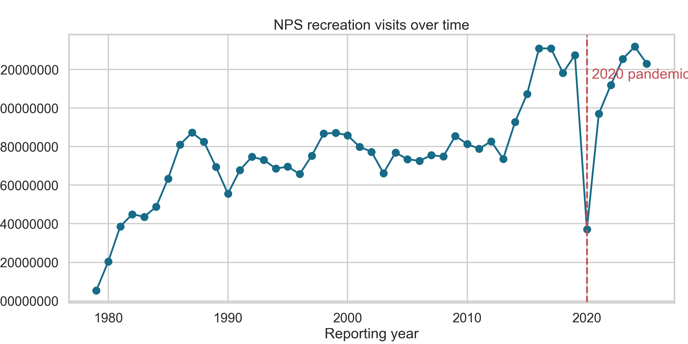
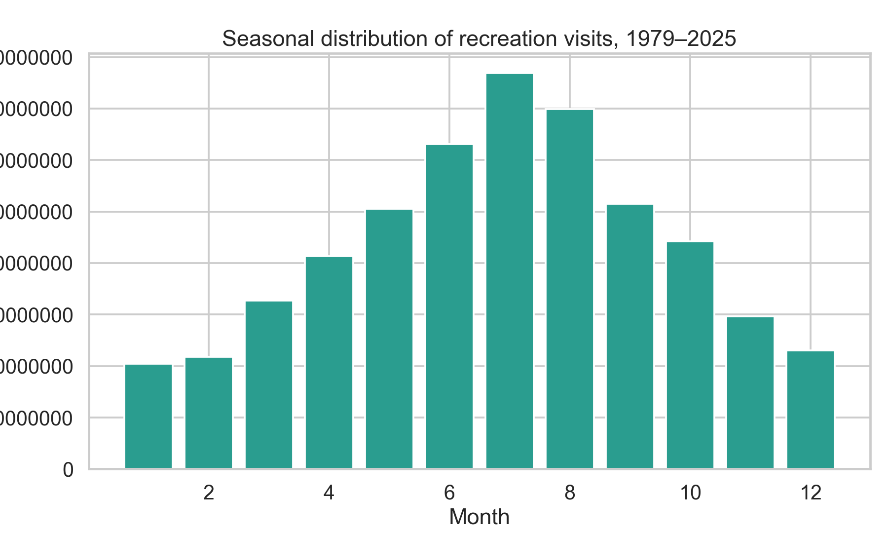
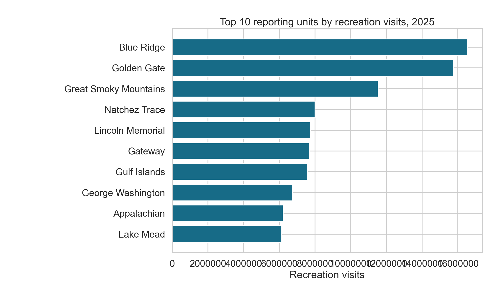

# Beyond the Crowds: Exploring What Drives National Park Visitation

A reproducible analysis of National Park Service recreation visits from 1979–2025, with careful attention to reporting units, seasonal patterns, and the limits of what visitation counts can say about crowding.

## Why I started this project

I enjoy visiting parks to observe nature. When I stay with my aunt in the Bronx, I sometimes walk to a nearby park, while other times I take a bus to a more distant park. I noticed that some parks felt much more crowded than others. That observation made me curious about whether there are broader factors associated with visitation.

Many parks in the Bronx are New York City municipal parks, not National Park Service units. This project studies NPS units nationwide, so its results are context for a different population, not direct evidence about the specific parks I visited.

## The main research question

Which characteristics and patterns are associated with higher NPS recreation visitation, and what can those patterns tell us without confusing visit counts with unique visitors or actual crowding?

## Data sources and methodology

The primary source is the official [NPS Visitor Use Statistics Data Package, 2025](https://catalog.data.gov/dataset/nps-visitor-use-statistics-data-package-2025), downloaded from the NPS DataStore. The XML metadata defines `TRV` as Recreation Visits. The project also saves an [official NPS API](https://developer.nps.gov/api/v1/parks?limit=500&api_key=DEMO_KEY) snapshot for park names, designations, states, and coordinates.

The pipeline validates columns, filters to `TRV`, converts numeric fields, checks duplicate unit-year-month-statistic keys, excludes four negative source records, aggregates monthly records to annual totals, and runs DuckDB summary SQL. A simple regression uses latitude, longitude, designation, and year with log-transformed visits and holds out whole parks during evaluation. Acreage and population proximity are not available in the verified sources used here and remain unresolved.

## Key findings

- Reported recreation visits totaled **327.5 million in 2019**, fell to **237.1 million in 2020**, and reached **323.0 million in 2025**.
- The three highest-volume reporting units in 2025 were Blue Ridge Parkway, Golden Gate National Recreation Area, and Great Smoky Mountains National Park.
- July, August, and June had the highest aggregate visit volume across the full period.
- The grouped model achieved a held-out `R²` of about **0.066** on log visits. Geography, designation, and year alone were weak explanatory variables in this benchmark.

These are descriptive associations. They do not show that any tested factor causes visitation or that a high visit count equals high on-site crowding.

## Figures







## Insights and possible decisions

The rankings and seasonal distribution can help identify where more specific operational questions are useful, such as when to examine staffing, transportation, reservation systems, or visitor communication. Those decisions should be tested with local measures such as entrance counts, trail counters, reservation data, and visitor experience surveys. The evidence supports conditional hypotheses, not causal claims.

## Limitations and future work

NPS visitor-use statistics are estimates of visits, not unique people or direct measures of density, queues, or crowding. Reporting coverage and counting procedures vary by unit and year. Park acreage is unavailable in the verified inputs, and visits per acre would not be a reliable direct crowding measure anyway. Population proximity and accessibility need time-matched Census and transportation data. Future work could add those sources, document their definitions, and use sensitivity analyses around park boundary and counting-method changes.

## Technologies

Python, Pandas, NumPy, DuckDB, Matplotlib, Seaborn, scikit-learn, Jupyter, and pytest.

## Reproduce

From the repository root:

```bash
python -m pip install -r requirements.txt
python scripts/download_data.py
python scripts/clean_data.py
pytest -q
```

Open [notebooks/01_exploratory_analysis.ipynb](notebooks/01_exploratory_analysis.ipynb) and [notebooks/02_factors_behind_visitation.ipynb](notebooks/02_factors_behind_visitation.ipynb) from the repository root. Raw downloads and generated outputs are ignored by Git; the scripts recreate them.
