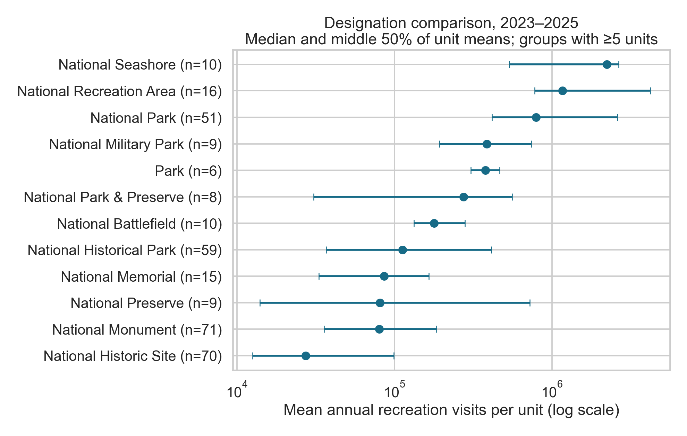

# Beyond the Crowds: Exploring What Drives National Park Visitation

A reproducible analysis of National Park Service recreation visits from 1979–2025, with careful attention to reporting units, seasonal patterns, and the limits of what visitation counts can say about crowding.

## Why I started this project

I enjoy visiting parks to observe nature. When I stay with my aunt in the Bronx, I sometimes walk to a nearby park, while other times I take a bus to a more distant park. I noticed that some parks felt much more crowded than others. That observation made me curious about whether there are broader factors associated with visitation.

Many parks in the Bronx are New York City municipal parks, not National Park Service units. This project studies NPS units nationwide, so its results are context for a different population, not direct evidence about the specific parks I visited.

## The main research question

Which characteristics and patterns are associated with higher NPS recreation visitation, and what can those patterns tell us without confusing visit counts with unique visitors or actual crowding?

## Data sources and methodology

The primary source is the official [NPS Visitor Use Statistics Data Package, 2025](https://catalog.data.gov/dataset/nps-visitor-use-statistics-data-package-2025), downloaded from the NPS DataStore. The XML metadata defines `TRV` as Recreation Visits. The project also saves an [official NPS API](https://developer.nps.gov/api/v1/parks?limit=500&api_key=DEMO_KEY) snapshot for park names, designations, states, and coordinates.

The pipeline validates monthly records and preserves an audit trail for questionable values. I compare annual totals and rankings, then use a consistent 2023–2025 cohort to study seasonality and differences between designations. A small regression benchmark checks whether designation and coordinates help predict visitation for held-out units. The descriptive comparisons are the main result; this is not a causal model.

## Key findings

- Recreation visits fell from **327.5 million in 2019 to 237.1 million in 2020 (−27.6%)**. The 2025 total was **323.0 million**, down **2.7%** from 2024.
- The top ten reporting units accounted for **29.1% of 2025 visits**. Blue Ridge Parkway led with **16.53 million**, followed by Golden Gate National Recreation Area (**15.75 million**) and Great Smoky Mountains National Park (**11.53 million**).
- Across **392 units** with complete, positive annual reporting in 2023–2025, July averaged **14.1%** of a unit's annual visits, followed by June (**12.4%**) and August (**11.9%**). Each unit and year receives equal weight.
- In the complete recent cohort, the median unit's mean annual visits were **1.16 million for National Recreation Areas (16 units)**, **792,493 for National Parks (51)**, and **27,335 for National Historic Sites (70)**. These are exact current API categories, not all units commonly called national parks.
- Across **25 held-out folds and 367 units**, designation plus coordinates achieved mean **R² = 0.303 (SD 0.103)** on **log1p mean annual visits**. Designation alone scored **0.273**; coordinates alone scored **−0.005**. This suggests designation carries useful information in this comparison, but leaves substantial variation unresolved.

Park purpose and setting appear relevant to visitation differences. These comparisons cannot tell whether designation itself attracts visits, or instead reflects attractions, access, nearby population, size, and counting practices. Visit counts are neither unique visitors nor measurements of crowding.

## Figures





## Insights and possible decisions

The rankings and seasonal distribution can help identify where more specific operational questions are useful, such as when to examine staffing, transportation, reservation systems, or visitor communication. Those decisions should be tested with local measures such as entrance counts, trail counters, reservation data, and visitor experience surveys. The evidence supports conditional hypotheses, not causal claims.

## Limitations and future work

NPS visitor-use statistics estimate visits, not unique people, queues, or density. Reporting codes increase from 271 in 1979 to 400 in 2025; the long-term total is not a fixed set of parks. All 400 codes have twelve months in 2025, and the total matches the official NPS release. Reporting codes are not interchangeable with the NPS count of 406 administrative units reporting that year.

Current metadata does not provide historical designations, and not every reporting code joins to the API. The recent cohort has 394 units, of which 367 have the fields required for the model. Four negative monthly counts are quarantined and 15 partial unit-years are flagged; historical totals remain sums of available nonnegative observations, not imputed full-year estimates. Details and sensitivity calculations are in the [findings report](reports/findings.md).

Acreage, population proximity, and accessibility remain unresolved: no compatible, time-matched join for those measures was established in this review. Their absence from the selected inputs does not mean official data do not exist elsewhere. Visits per acre would still not directly measure crowding. A useful next step would be a small, carefully matched study of gateway population and travel access, checked against local counting methods.

## Technologies

Python, Pandas, NumPy, DuckDB, Matplotlib, Seaborn, scikit-learn, Jupyter, and pytest.

## Reproduce

Tested with Python 3.14 and the pinned dependencies. From a clean clone:

```bash
git clone https://github.com/amgazal/national-parks-visitation-analysis.git
cd national-parks-visitation-analysis
python3 -m venv .venv
source .venv/bin/activate
python -m pip install -r requirements.txt
python scripts/download_data.py
python scripts/clean_data.py
python -m pytest -q
python scripts/execute_notebooks.py
```

On Windows, activate with `.venv\Scripts\activate`. Downloads require internet access; the public NPS API demo key can be rate-limited. Failed downloads raise an error and retain the previous file. Keep the generated source manifest to identify your snapshot; the current API can change and is not a frozen historical source.

The notebook runner executes both notebooks with fresh kernels in the active Python environment. You can also open them interactively with Jupyter. `src/analysis.py` holds shared analysis functions, `scripts/` rebuilds outputs, `reports/` contains small auditable result tables, and `figures/` contains the displayed charts. Large raw files and processed tables are ignored; charts, reports, and executed notebooks are committed.

See [data provenance](data/README.md), the [technical findings](reports/findings.md), and [portfolio and resume copy](docs/portfolio-resume-copy.md).
